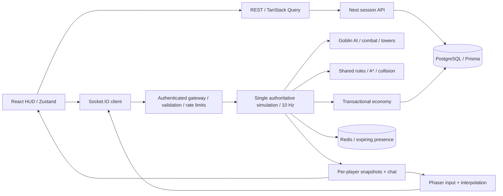

# Lord of the Logs

**Todo reino começa com um tronco.** Um mundo isométrico multiplayer persistente em pixel art: colete, construa, plante, forje, enfrente goblins e cumpra missões ao lado de outros viajantes. Tudo é validado pelo servidor e salvo no PostgreSQL. Projeto de portfólio fullstack.


## Três repositórios independentes

| Repositório                                                                          | Responsabilidade                                                   |
| ------------------------------------------------------------------------------------ | ------------------------------------------------------------------ |
| **[lord-of-the-logs](https://github.com/leonardoferri1/lord-of-the-logs)** (este)    | Servidor NestJS, banco, testes de integração e orquestração Docker |
| [lord-of-the-logs-web](https://github.com/leonardoferri1/lord-of-the-logs-web)       | Cliente React/Phaser e proxy Nginx                                 |
| [lord-of-the-logs-shared](https://github.com/leonardoferri1/lord-of-the-logs-shared) | Contratos e regras determinísticas, com testes de domínio          |

Cada repositório possui seu próprio manifesto, lockfile e CI. Cliente e servidor fixam a mesma revisão do pacote compartilhado pelo SHA do commit. O Compose deste repositório busca uma revisão fixa do cliente no GitHub, portanto a execução completa não exige manter três checkouts locais. Não há pnpm workspace ou dependência entre pastas locais. Para trabalhar nos três ao mesmo tempo, é conveniente cloná-los lado a lado numa mesma pasta (por exemplo `lord-of-the-logs/`).

## O que há no vale

- **Mundo de 48 × 48** com sete regiões: Vila do Rio, Floresta Sombria, Montanhas Cinzentas, Campos do Sol, Bosque Rubro, Lago Espelhado e Vale do Carvalho. Rio com pontes, cais, lago e ilhas com encostas.
- **Recursos:** madeira, pedra, ferro e comida (arbustos de frutas), além de ouro. Cada coleta gasta energia e rende conforme o nível da ferramenta.
- **Progressão:** níveis com curva de experiência, vida máxima crescente e energia que regenera (mais rápido perto da sua casa).
- **Combate:** três acampamentos goblins com IA de perseguição, retorno e reaparecimento. Goblins e guerreiros deixam ouro, ferro e XP. Cair em combate custa 10% do ouro.
- **Construções com função:** casa (descanso), plantação (plantar e colher), serraria e armazém (produção passiva) e torre de vigia (atira flechas em goblins). Novas estruturas são liberadas por nível.
- **Moradores:** o ferreiro aprimora espada, machado e picareta em quatro níveis; a mercadora compra recursos e vende comida e ferro.
- **13 missões encadeadas** com recompensas de XP e ouro, três ativas por vez.
- **Conversa global** com histórico, mensagens do sistema e limites de envio.
- Ciclo de dia e noite compartilhado, janelas e tochas iluminadas, mapa do mundo e minimapa com bússola.
- Som sintetizado no navegador: efeitos posicionais, ambiente que muda com a hora e o lugar e música de fundo, com volumes ajustáveis.

## Jogar localmente

Requisitos: Docker Desktop/Engine com Compose, Git. Para desenvolvimento fora dos containers: Node.js 22 LTS e pnpm 9.15.9.

```sh
git clone https://github.com/leonardoferri1/lord-of-the-logs.git
cd lord-of-the-logs
docker compose up --build -d
```

Abra **http://localhost:8080**. A primeira execução baixa imagens, compila as aplicações e aplica as migrations. O banco usa volume persistente; `docker compose down` preserva o mundo. **`docker compose down -v` apaga o mundo**, portanto não use para uma reinicialização normal.

1. Escolha um apelido; nenhuma conta é necessária.
2. Clique numa árvore, rocha, veio de ferro ou arbusto. O personagem caminha até lá e coleta sozinho até esgotar ou faltar energia.
3. Resgate as missões no painel à direita. Ao subir de nível, abra **B** para construir: a casa custa 12 madeiras e 4 pedras.
4. Na praça, clique no **ferreiro** para forjar ferramentas melhores e na **mercadora** para negociar.
5. Clique num goblin para atacar. Comece pela Floresta Sombria, ao norte; os guerreiros do Bosque Rubro são mais fortes.
6. Abra outra aba e escolha **um novo nome** para testar dois jogadores. Converse com **Enter**.
7. Recarregue para recuperar a sessão da aba. Ao reabrir o navegador, **Continuar como…** recupera o último personagem salvo neste navegador, por até 30 dias.

Atalhos: **I** inventário, **B** construção, **M** mapa, **J** missões, **H** guia, **1–8** barra de ferramentas (6 come), **E** coletar ou usar a construção selecionada, **F** centralizar, **N** silenciar, **Esc** cancelar. Setas ou arraste com botão direito movem a câmera; scroll ajusta o zoom.

## Desenvolvimento

```sh
corepack enable
pnpm install --frozen-lockfile
docker compose up -d db redis
```

Copie `.env.example` para `.env` (PowerShell: `Copy-Item .env.example .env`; macOS/Linux: `cp .env.example .env`). Depois, neste repositório:

```sh
pnpm db:generate
pnpm db:migrate
pnpm dev
```

Em outro terminal, prepare o cliente independente:

```sh
git clone https://github.com/leonardoferri1/lord-of-the-logs-web.git
cd lord-of-the-logs-web
pnpm install --frozen-lockfile
pnpm dev
```

Abra **http://localhost:5173**. O Vite encaminha REST e Socket.IO para a porta 3001. Não execute o servidor de desenvolvimento e o servidor do Compose simultaneamente na mesma porta. Para alternar: `docker compose stop server web`. Não é necessário clonar o pacote compartilhado para executar as aplicações: a instalação baixa a revisão fixada.

| Serviço                | Porta local | Configuração                             |
| ---------------------- | ----------- | ---------------------------------------- |
| Web em Docker          | 8080        | Nginx, assets estáticos e proxy          |
| Web em desenvolvimento | 5173        | Vite                                     |
| Servidor               | 3001        | `PORT`, `CLIENT_ORIGIN`                  |
| PostgreSQL             | 55432       | `DATABASE_URL`; interna ao Compose: 5432 |
| Redis                  | 6379        | `REDIS_URL`, opcional fora do Compose    |

As credenciais de exemplo servem apenas para desenvolvimento. `CLIENT_ORIGIN` configura o servidor Node local; `WEB_ORIGIN` configura a origem usada pelo Compose. O frontend usa a mesma origem por padrão; `VITE_API_URL` permite uma API separada e precisa ser definida no build do cliente.

### Versão do mundo

O mapa é gerado pelo pacote compartilhado (`WORLD_VERSION = 2`). Ao iniciar sobre um banco da versão 1, o servidor executa uma migração explícita sob o advisory lock: recria os recursos na nova geometria, remove construções que ficariam em terreno inválido **devolvendo o custo ao dono**, move todos os personagens para a vila e registra um `WorldEvent` do tipo `migration`. Bancos de versão futura são recusados.

## Stack e organização

| Área                         | Tecnologias e responsabilidade                                                                   |
| ---------------------------- | ------------------------------------------------------------------------------------------------ |
| Cliente independente         | React 19, Vite, TypeScript, Phaser 3 (pixel art procedural), Tailwind 4, Zustand, TanStack Query |
| `src` e `prisma` (este repo) | NestJS 11, Socket.IO, Prisma 6, PostgreSQL 17, Redis 7                                           |
| Pacote `@logs/shared`        | Mundo, regiões, A*, regras de economia, progressão, combate, missões e contratos Zod             |
| `tests`                      | Integração com PostgreSQL real, servidor Node e clientes Socket.IO                               |
| Infraestrutura               | Compose/Dockerfile neste repo; Nginx/Dockerfile no cliente                                       |



O cliente envia **intenções**: destino, recurso, alvo, construção, troca, aprimoramento ou missão. Nunca envia inventário, dano, recompensa ou posição autorizada. O servidor calcula caminhos, avança uma célula a cada 300 ms num tick de 100 ms, simula goblins e torres, aplica dano e regenera vida e energia. Phaser interpola a posição visual por frame; React cuida apenas do HUD. O banco recebe checkpoints de posição, vida e energia a cada 5 segundos e na desconexão.

Toda mutação econômica (coleta, construção, saque de goblin, penalidade, missão, forja, troca, comida, plantação, produção e descanso) usa uma transação com um advisory lock compartilhado e grava um recibo de idempotência. Uma chave única por célula protege contra construções sobrepostas; constraints impedem inventários negativos, níveis de ferramenta fora do intervalo e quantidades fora do limite. Os snapshots só reenviam a lista de recursos quando ela muda. Veja [arquitetura](docs/ARCHITECTURE.md).

## Verificação

```sh
pnpm lint
pnpm db:generate
pnpm build
pnpm test
```

`pnpm test` (também disponível como `pnpm test:integration`) executa os 7 testes de integração deste servidor. Exige PostgreSQL acessível e o build atualizado. Por padrão usa `localhost:55432`; `DATABASE_URL` substitui esse endereço. Cria um **schema temporário isolado**, executa todas as migrations nele, inicia um servidor na porta 3101 e remove apenas esse schema ao terminar. Não use credenciais de produção para testes. No repositório compartilhado, `pnpm test` executa os 11 testes de domínio; no cliente, `pnpm lint` e `pnpm build` validam a aplicação de forma independente.

Cobertura comportamental:

- Conversão isométrica, terreno determinístico, alcançabilidade de acampamentos e moradores, A* sem atravessar obstáculos.
- Footprints, estradas, acampamentos, nível mínimo, alcance e custos de construção; produção, plantio e descanso.
- Curva de experiência, progresso e encadeamento de missões, rendimento por ferramenta.
- Rejeição de identidade forjada, coordenadas inválidas e mensagens com caracteres de controle.
- Dois clientes observam movimento, coleta temporizada, inventário e a mesma construção; reconexão e **reinício real do processo** restauram tudo.
- Coletas e construções concorrentes não duplicam recursos; repetição de ação não duplica itens.
- Saque de goblin idempotente, resgate de missão só quando concluída, troca e forja só ao lado do morador.
- Um personagem real persegue e derrota um goblin pela rede e recebe o saque; a conversa chega ao outro jogador.

GitHub Actions executa lint, testes, build e integração contra PostgreSQL. Consulte [registro de validação](docs/VALIDATION.md) para detalhes e limites.

## Direção visual

Pixel art original, pintada em código: sombreamento com dithering ordenado, contornos, encostas de terra sob a costa, água com espuma e brilhos, telhados de telhas e janelas acesas. O HUD segue o mesmo estilo — retrato, barras de vida e energia, menu lateral, moedas, bússola, missões, barra de ferramentas com XP e conversa — e os ícones vêm dos mesmos sprites do jogo. O som segue a mesma regra: é sintetizado com Web Audio, sem arquivos gravados. Não há sprites, nomes, personagens ou imagens de franquias externas; a única fonte externa é a Pixelify Sans (OFL), empacotada no cliente.

## Limitações honestas

- Um processo autoritativo, um mundo de 48 × 48 células, sem particionamento ou alta disponibilidade. Redis registra presença; **não torna a simulação horizontalmente escalável**. Goblins vivem em memória e reaparecem após um reinício.
- Snapshots de jogadores, goblins e efeitos a 10 Hz simplificam ressincronização, mas consomem mais banda que deltas e interest management. O projeto não possui benchmark de capacidade de produção.
- A identidade anônima é um bearer token. Quem controla o navegador controla o personagem. Não há recuperação por e-mail, contas, moderação de conversa ou proteção robusta contra múltiplas identidades. O histórico da conversa fica só em memória.
- Uma coleta interrompida antes do commit é cancelada. Em queda abrupta, posição, vida e energia podem voltar até o último checkpoint, mas a economia já confirmada permanece salva.
- Personagens não bloqueiam movimento uns dos outros; goblins evitam ocupar a mesma célula. A IA dos goblins é gulosa e pode contornar mal obstáculos grandes.
- Desktop primeiro; o HUD se adapta a telas menores, mas não há câmera multitoque ou navegação completa do canvas por leitor de tela.
- Sem PvP, clãs, comércio entre jogadores ou durabilidade das construções.

## Publicação e próximos passos

O repositório contém uma demo executável; **não pressupõe um servidor de jogo já hospedado na internet**. Para publicar, use um host que suporte containers e conexões WebSocket duradouras, TLS no proxy, domínio/origem configurados, banco com backup e volumes persistentes. Exponha apenas a web; banco, Redis e API direta devem ficar em rede privada. O proxy deve repassar IPs confiáveis e o app precisa de uma política explícita de `trust proxy` antes de usar rate limits por IP atrás dele.

Roadmap: clãs e canal de clã; deltas e interesse espacial; métricas e testes de carga; moderação; navegação touch; backups. Só depois: zonas com autoridade independente, handoff de jogadores e coordenação distribuída.
