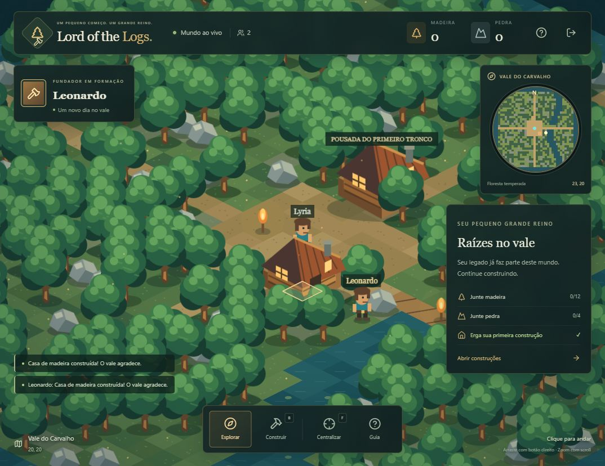
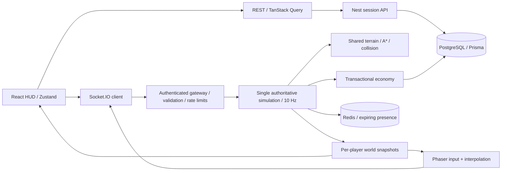

# Lord of the Logs

**Todo reino começa com um tronco.** Um mundo isométrico multiplayer persistente, com coleta e construção validadas pelo servidor. Projeto de portfólio fullstack: o cenário é jogável, o inventário vive no PostgreSQL e dois navegadores compartilham as mesmas construções.



## Três repositórios independentes

| Repositório                                                                          | Responsabilidade                                                   |
| ------------------------------------------------------------------------------------ | ------------------------------------------------------------------ |
| **[lord-of-the-logs](https://github.com/leonardoferri1/lord-of-the-logs)** (este)    | Servidor NestJS, banco, testes de integração e orquestração Docker |
| [lord-of-the-logs-web](https://github.com/leonardoferri1/lord-of-the-logs-web)       | Cliente React/Phaser e proxy Nginx                                 |
| [lord-of-the-logs-shared](https://github.com/leonardoferri1/lord-of-the-logs-shared) | Contratos e regras determinísticas, com testes de domínio          |

Cada repositório possui seu próprio manifesto, lockfile e CI. Cliente e servidor fixam a mesma revisão do pacote compartilhado pelo SHA do commit. O Compose deste repositório busca uma revisão fixa do cliente no GitHub, portanto a execução completa não exige manter três checkouts locais. Não há pnpm workspace ou dependência entre pastas locais.

## Jogar localmente

Requisitos: Docker Desktop/Engine com Compose, Git. Para desenvolvimento fora dos containers: Node.js 22 LTS e pnpm 9.15.9.

```sh
git clone https://github.com/leonardoferri1/lord-of-the-logs.git
cd lord-of-the-logs
docker compose up --build -d
```

Abra **http://localhost:8080**. A primeira execução baixa imagens, compila as aplicações e aplica as migrations. O banco usa volume persistente; `docker compose down` preserva o mundo. **`docker compose down -v` apaga o mundo**, portanto não use para uma reinicialização normal.

1. Escolha um apelido; nenhuma conta é necessária.
2. Clique em uma árvore ou pedra. Seu personagem procura um caminho até um local adjacente.
3. Clique em **Coletar recurso** ou pressione **E**. A coleta leva 1,5 segundo e entrega até 4 unidades.
4. Junte 12 madeiras e 4 pedras para uma casa. Abra **B**, escolha a construção e clique em uma área livre a até 6 passos.
5. Abra outra aba e escolha **um novo nome** para testar dois jogadores independentes. Você verá movimento e construção compartilhados.
6. Recarregue para recuperar a sessão da aba. Ao reabrir o navegador, **Continuar como…** recupera o último personagem salvo neste navegador, por até 30 dias.

Setas ou arraste com botão direito movem a câmera; scroll ajusta o zoom; **F** centraliza; **Esc** fecha painéis e cancela o modo de construção. Recursos esgotados regeneram em aproximadamente 45 segundos. Casas, serrarias, depósitos e torres são estruturas persistentes, sem bônus passivos nesta versão.

## Desenvolvimento

```sh
corepack enable
pnpm install --frozen-lockfile
docker compose up -d db redis
```

Copie `.env.example` para `.env` (PowerShell: `Copy-Item .env.example .env`; macOS/Linux: `cp .env.example .env`). Depois, neste repositório:

```sh
pnpm db:generate
pnpm db:migrate
pnpm dev
```

Em outro terminal, prepare o cliente independente:

```sh
git clone https://github.com/leonardoferri1/lord-of-the-logs-web.git
cd lord-of-the-logs-web
pnpm install --frozen-lockfile
pnpm dev
```

Abra **http://localhost:5173**. O Vite encaminha REST e Socket.IO para a porta 3001. Não execute o servidor de desenvolvimento e o servidor do Compose simultaneamente na mesma porta. Para alternar: `docker compose stop server web`. Não é necessário clonar o pacote compartilhado para executar as aplicações: a instalação baixa a revisão fixada.

| Serviço                | Porta local | Configuração                             |
| ---------------------- | ----------- | ---------------------------------------- |
| Web em Docker          | 8080        | Nginx, assets estáticos e proxy          |
| Web em desenvolvimento | 5173        | Vite                                     |
| Servidor               | 3001        | `PORT`, `CLIENT_ORIGIN`                  |
| PostgreSQL             | 55432       | `DATABASE_URL`; interna ao Compose: 5432 |
| Redis                  | 6379        | `REDIS_URL`, opcional fora do Compose    |

As credenciais de exemplo servem apenas para desenvolvimento. `CLIENT_ORIGIN` configura o servidor Node local; `WEB_ORIGIN` configura a origem usada pelo Compose. O frontend usa a mesma origem por padrão; `VITE_API_URL` permite uma API separada e precisa ser definida no build do cliente. O `.env` deste repositório contém as configurações locais do backend e do Compose.

## Stack e organização

| Área                         | Tecnologias e responsabilidade                                                         |
| ---------------------------- | -------------------------------------------------------------------------------------- |
| Cliente independente         | React 19, Vite, TypeScript, Phaser 3, Tailwind 4, Zustand, TanStack Query e Lucide     |
| `src` e `prisma` (este repo) | NestJS 11, Socket.IO, Prisma 6, PostgreSQL 17, Redis 7                                 |
| Pacote `@logs/shared`        | Terreno determinístico, A*, coordenadas isométricas, colisão, receitas e contratos Zod |
| `tests`                      | Integração com PostgreSQL real, servidor Node e clientes Socket.IO                     |
| Infraestrutura               | Compose/Dockerfile neste repo; Nginx/Dockerfile no cliente                             |



O cliente envia **intenções**: destino, recurso ou tipo/local de construção. Nunca envia um inventário confiável, quantidade de recompensa ou posição autorizada. O servidor calcula o caminho e avança uma célula a cada 300 ms, num tick de 100 ms. Phaser interpola a posição visual por frame; React cuida apenas do HUD. O banco recebe checkpoints de posição a cada 5 segundos e na desconexão, não a cada frame.

Coletas e construções usam uma transação com um advisory lock compartilhado. Dentro dela, o servidor relê o estado, valida regras, altera inventário, registra o evento e grava um recibo de idempotência. Uma chave única por célula protege contra construções sobrepostas; constraints impedem inventários negativos e quantidades fora do limite. O lock global favorece correção e simplicidade neste mundo pequeno, sacrificando throughput. Veja [arquitetura](docs/ARCHITECTURE.md).

## Verificação

```sh
pnpm lint
pnpm db:generate
pnpm build
pnpm test
```

`pnpm test` (também disponível como `pnpm test:integration`) executa os 5 testes de integração deste servidor. Exige PostgreSQL acessível e o build atualizado. Por padrão usa `localhost:55432`; `DATABASE_URL` substitui esse endereço. Cria um **schema temporário isolado**, executa as migrations nele, inicia um servidor na porta 3101 e remove apenas esse schema ao terminar. Não use credenciais de produção para testes. No repositório compartilhado, `pnpm test` executa os 6 testes de domínio; no cliente, `pnpm lint` e `pnpm build` validam a aplicação de forma independente.

Cobertura comportamental:

- Conversão isométrica de todas as células, terreno determinístico e A* sem atravessar obstáculos.
- Validação de alcance, ocupação, footprints e custos.
- Rejeição de identidade forjada e coordenadas inválidas.
- Dois clientes observam movimento, coleta temporizada, inventário e a mesma construção.
- Repetição de ação não duplica itens ou construções.
- Reconexão e **reinício real do processo** restauram construções e inventário.
- Duas coletas disputando o estoque final não duplicam recursos.
- Duas construções concorrentes no mesmo terreno: apenas uma vence e a outra não perde recursos.
- Regeneração e validação de alcance no momento do commit.

GitHub Actions executa lint, testes, build e integração contra PostgreSQL. A validação local inicial passou com **6 testes de domínio e 5 testes de integração**; a interface também foi exercitada no navegador. Consulte [registro de validação](docs/VALIDATION.md) para detalhes e limites.

## Direção visual

Interface em português, floresta verde, madeira âmbar e painéis discretos de pedra escura. As texturas são originais, desenhadas em código e convertidas em texturas reutilizáveis pelo Phaser. Não há sprites, nomes, personagens ou imagens de franquias externas. Lucide fornece os ícones da interface. A pousada central e as tochas são cenário; construções de jogadores são persistidas separadamente.

## Limitações honestas

- Um processo autoritativo, um mundo de 38 × 38 células, sem particionamento ou alta disponibilidade. Redis registra presença; **não torna a simulação horizontalmente escalável**.
- Snapshots completos a 10 Hz simplificam ressincronização, mas consomem mais banda que deltas e interest management. O projeto não possui benchmark de capacidade de produção.
- A identidade anônima é um bearer token. Quem controla o navegador controla o personagem. Não há recuperação por e-mail, contas, moderação ou proteção robusta contra múltiplas identidades.
- O navegador guarda o último personagem para retorno. Nova aba começa sem jogador conectado; duplicar uma aba pode copiar `sessionStorage`. Se duas conexões usam o mesmo token, a mais recente assume o personagem.
- Uma coleta interrompida antes do commit é cancelada. Um commit em andamento pode terminar depois da desconexão; a ressincronização recupera o resultado. Em queda abrupta, a posição pode voltar até o último checkpoint, mas a economia já confirmada permanece salva.
- Personagens não bloqueiam movimento uns dos outros. Construções não podem ocupar células de personagens presentes, recursos, água, pousada ou vias principais. Recursos esgotados continuam bloqueando a célula até regenerar.
- Desktop primeiro; HUD adapta-se a telas menores, mas não há câmera multitoque ou navegação completa do canvas por leitor de tela.
- Sem combate, PvP, clãs, crafting avançado, NPCs interativos ou efeitos econômicos das construções. Integridade é metadado reservado para evoluções.

## Publicação e próximos passos

O repositório contém uma demo executável; **não pressupõe um servidor de jogo já hospedado na internet**. Para publicar, use um host que suporte containers e conexões WebSocket duradouras, TLS no proxy, domínio/origem configurados, banco com backup e volumes persistentes. Exponha apenas a web; banco, Redis e API direta devem ficar em rede privada. O proxy deve repassar IPs confiáveis e o app precisa de uma política explícita de `trust proxy` antes de usar rate limits por IP atrás dele.

Roadmap: deltas e interesse espacial; métricas e testes de carga; gestão de sessões e moderação; construções com produção e crafting; navegação touch; backups e migrações de versões do mapa. Só depois: zonas com autoridade independente, handoff de jogadores e coordenação distribuída.
