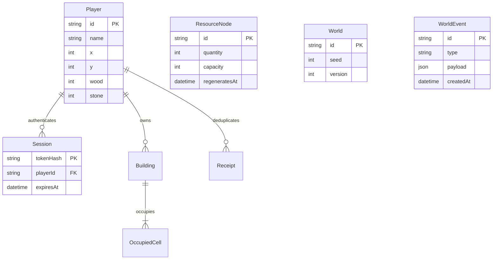

# Architecture decisions

## Authority boundary

The independently versioned `@logs/shared` package contains deterministic rules, not trusted client state. A browser may use those rules for feedback, but the server repeats every economically relevant validation. Both repositories pin the same Git commit; changes to contracts require coordinated upgrades. The gateway validates strict Zod payloads and authenticates a 256-bit bearer credential. PostgreSQL stores only its SHA-256 hash and expiration. Each socket is bound to a player through the validated session, never through a supplied player ID.

REST: `POST /api/sessions`, `GET /api/me`, `GET /api/world`, `GET /api/health`. Socket intentions: `move`, `gather`, `build`, `resync`. Server events: `snapshot`, `result`, `activity`. A snapshot carries all public entities and only the receiving player's inventory. Join sends a full snapshot; automatic Socket.IO reconnect authenticates again and replaces stale state. The server loads its world before becoming ready.

## Movement and construction safety

A* uses four neighbors and a Manhattan heuristic. Bounds, water, resources, the inn and building footprints define collision. A fixed 10 Hz loop advances at most one cell per 300 ms; delayed ticks do not speed a player up. Client interpolation cannot alter the authoritative position. New structures invalidate blocked remaining path steps. Simulation movement pauses during construction commits so a character cannot enter a footprint between validation and commit.

Players may share cells; this avoids doorway deadlocks in the cooperative MVP. Roads remain unbuildable, keeping the spawn and primary routes open. Arbitrary placement can still enclose off-road regions: grief-resistant zoning is future work.

## Atomic economy

```mermaid
sequenceDiagram
  participant C as Browser
  participant S as Simulation
  participant P as PostgreSQL
  participant O as Other players
  C->>S: build(kind, tile, actionId)
  S->>S: Authenticate / validate / rate limit / pause movement
  S->>P: BEGIN (ReadCommitted)
  S->>P: Acquire transaction advisory lock
  S->>P: Read receipt(playerId, actionId)
  alt Existing receipt
    P-->>S: Previous result; no economic write
  else New action
    S->>P: Read current world and inventory
    S->>S: Check range, terrain, occupancy, players and costs
    S->>P: Deduct costs + insert building and unique occupied cells
    S->>P: Insert event and receipt
  end
  S->>P: COMMIT
  S->>S: Refresh cache / resume movement
  S-->>C: Result + authoritative snapshot
  S-->>O: Updated world snapshot
```

All economy writers (including regeneration) acquire the same transaction-scoped advisory lock. With PostgreSQL ReadCommitted, statements after acquiring it see prior committed changes. A process crash automatically releases the lock and rolls back uncommitted writes. Unique occupied-cell keys and quantity constraints provide additional database-level protection.

The gathering timer is an in-memory intention. At completion the store rechecks range and current node quantity, awards `min(4, remaining)`, decrements the node and creates a receipt in one transaction. The timer does not reserve resources: another player may win the final stock. Depleted nodes receive a regeneration timestamp, and maintenance restores them after the deadline, including after restart.

Idempotency keys are scoped to a player, shared across economic action types, and retained indefinitely in this MVP. A successful duplicate returns its original message. Rejected actions create no receipt and charge nothing. A production retention policy must not allow old keys to replay within the supported retry window.

## Persistence model



Static terrain is generated from a checked-in algorithm and seed. Mutable resources, players and buildings live in PostgreSQL. Initialization inserts missing seed nodes without resetting existing quantities. Changing map geometry requires an explicit versioned migration; silently changing the seed would invalidate existing structures.

## Abuse and failure cases

| Scenario                                 | Behavior / limitation                                                              |
| ---------------------------------------- | ---------------------------------------------------------------------------------- |
| Forged player ID or invalid token        | Rejected; socket authority comes from the hashed session lookup                    |
| Teleport/out-of-bounds/fractional input  | Strict schema and server-computed path                                             |
| Remote gathering or build                | Range checked server-side, including gathering completion                          |
| Repeated successful action ID            | Stored receipt; no duplicate inventory mutation                                    |
| Competing final harvest / same placement | Serialized transaction; unique footprint cells; loser does not pay                 |
| Socket flood                             | Token bucket: burst 20, refill 10/s, per connected identity                        |
| Session creation flood                   | 20 attempts per minute per observed IP; not a distributed anti-Sybil system        |
| Huge socket payload                      | 4 KiB Socket.IO limit                                                              |
| SQL injection                            | Prisma parameterized writes; test-only schema identifiers are generated internally |
| Nickname injection                       | Restricted characters; rendered as React text / canvas text                        |
| Database unavailable                     | Health fails; no fake connected mode or client-only writes                         |
| Redis unavailable                        | Presence cache degraded; PostgreSQL gameplay remains authoritative                 |
| Server restart                           | Reconnect reauthenticates and receives complete persisted state                    |

TLS is mandatory for a public deployment. Local browser storage is not an XSS-resistant credential vault. Session revocation, distributed rate limits, observability, CSP hardening and cleanup/retention jobs are deployment work, not claims of this MVP. Do not expose the development Vite server as production hosting.

## Scaling path

Current topology deliberately has one authority. Running two server replicas would create competing movement timers and caches even though database transactions protect inventory. Redis presence is not a distributed simulation lock.

The next steps are binary/delta snapshots and interest management, capacity measurement, a durable event publication/outbox strategy, then per-zone ownership with leases and explicit cross-zone handoff. Economy locks can become per-player/per-node locks in stable order to reduce contention. Partitioning requires rules for structures and interactions spanning zones; it is not solved by adding a Socket.IO Redis adapter.
